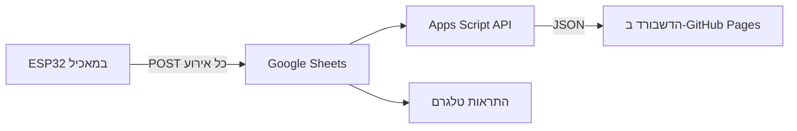

# PanzziFeeder 🐈

מאכיל חתולים אוטומטי. החתול לוחץ על פדל, סרוו משחרר גרגרים, וחיישנים מדווחים מה קרה. הריפו הזה הוא הדשבורד: דף אינטרנט שמראה בזמן אמת אם המאכיל עובד והחתול אוכל.

## איך זה עובד



| רכיב | איפה רץ | מה עושה |
|---|---|---|
| ESP32 | במאכיל | פדל, סרוו עם ניעור, חיישן קול בקערה, חיישן מרחק (HC-SR04) ולחות (DHT11) במיכל |
| Google Sheets | Google | כל אירוע נכתב כשורה בלשונית `events` |
| `apps-script/Api.gs` | Google Apps Script | מחזיר JSON עם הנתונים של 3 הימים האחרונים. הגיליון עצמו נשאר פרטי |
| `index.html`, `app.js`, `style.css` | GitHub Pages (בדפדפן) | כל החישובים, הגרפים וההתראות |

הדשבורד לא משתמש בספריות חיצוניות: הגרפים מצוירים ב-SVG בתוך `app.js`.

## הגדרות

- **הנפקה מוצלחת**: חיישן הקול קלט לפחות גרגר אחד (`snd ≥ 1`). כל `snd` הוא גרגר אחד.
- **אתחול**: שורת `boot`, או שעון הבקר (`device_ms`) שהתאפס. שורת האתחול לפעמים הולכת לאיבוד כשהבקר עולה לפני ה-Wi-Fi.
- **אוכל במיכל**: לפי מודל של צורת המיכל (30 ס"מ גובה, 16 ס"מ קוטר בשפה, מצר כלפי מטה). החיישן נמצא 2.6 ס"מ מתחת לשפה, ומיכל מלא הוא כ-4 ליטר. קריאות מתחת ל-1 ס"מ או מעל 35 ס"מ (מכסה פתוח) לא נספרות.
- **התראות**:
  - המאכיל לא שולח נתונים יותר משעה.
  - 12 שעות בלי הנפקה מוצלחת.
  - לחות מעל 65% במשך יותר מ-6 שעות.
  - 3 אתחולים ומעלה ב-24 שעות.
  - פחות מ-20% אוכל במיכל.

את כל ההגדרות אפשר לשנות בראש הקובץ `app.js`.

## התקנה

### 1. ה-API ב-Apps Script
1. בגיליון: Extensions ← Apps Script.
2. ליד Files לוחצים ‎+‎ ← Script, קוראים לו `Api` ומדביקים את `apps-script/Api.gs`.
3. ב-`PanzziFeeder_Sheets.gs` מחליפים **רק** את הפונקציה `doGet` בשורה:
   ```js
   function doGet(e) { return apiGet_(e); }
   ```
4. מריצים פעם אחת את `testApi` ומאשרים הרשאות.
5. Deploy ← New deployment ← Web app. בוחרים Execute as: **Me**, Who has access: **Anyone**, לוחצים Deploy ומעתיקים את הכתובת (נגמרת ב-`/exec`).
   הפריסה הקיימת שה-ESP32 שולח אליה לא משתנה.

### 2. הדשבורד ב-GitHub Pages
1. מכניסים את הכתובת מהשלב הקודם ל-`config.js`.
2. Settings ← Pages ← Source: **Deploy from a branch**, Branch: `main`, Folder: `/ (root)` ← Save.
3. אחרי דקה הדף נמצא בכתובת `https://<שם-המשתמש>.github.io/<שם-הריפו>/`.

כל עוד `config.js` ריק, הדף מציג נתוני דוגמה מתוך `demo/sample-data.json` (צילום של נתונים אמיתיים מ-06–08/11/2026).

## פרטיות

הכתובת של ה-API ציבורית, וכל מי שיש לו אותה רואה את האירועים של 3 הימים האחרונים: זמנים, גרגרים, לחות ומרחק. הגיליון עצמו, המפתח של ה-ESP32 וטוקן הטלגרם לא נחשפים. **אף פעם לא להעלות לריפו את `PanzziFeeder_Sheets.gs` עם המפתח האמיתי.**

## עדכון קוד ב-Apps Script

Deploy ← Manage deployments ← עריכה (עיפרון) ← Version: **New version** ← Deploy. הכתובת נשארת אותה כתובת.
